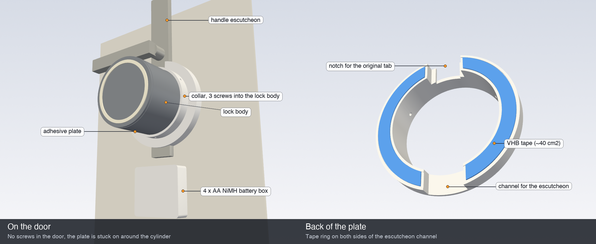

# 🔋 Self-adhesive, battery powered (experimental)

For rentals where you can't screw anything to the door, and with no power socket nearby.

| Part | Notes |
| :-- | :-- |
| `adhesive_mount.stl` | Ring plate stuck to the door around the lock cylinder with **3M VHB** tape (e.g. 4910 / 5952, 1 mm). A collar holds the lock's `bottom` part with 3 × M3 self-tapping screws. A channel on the back straddles a long handle escutcheon: set `ESCUTCHEON_WIDTH` / `ESCUTCHEON_DEPTH` to your door, or `0` for a round rosette. Cut off the original mounting tab, or use the notch. |
| `battery_box.stl` + `battery_lid.stl` | Holds a standard 4 × AA flat battery holder (with leads). Stick it below the lock with VHB, and the cable runs into the lock. |

Use **4 × AA NiMH** (Eneloop or similar), not alkaline: see [the V4 board notes](../../PCB/V4-low-power/README.md#batteries).

**Mounting:** clean the door and the plate with isopropyl alcohol, apply the tape, press firmly for 30 s, and let it cure for 24 h before the first use. Roughly 40 cm² of tape holds about 20× the torque the servo can produce.

The battery version needs the [V4 low power board](../../PCB/V4-low-power/README.md) (ESP32-C3) and the `smartlock-battery` firmware build. The estimate is **~5-7 weeks** on 2000 mAh NiMH cells at ~10 movements a day. It has not been measured yet, so check it with a meter as described there.

All parts are parametric: `pip install manifold3d trimesh`, then `python adhesive_mount.py`.
