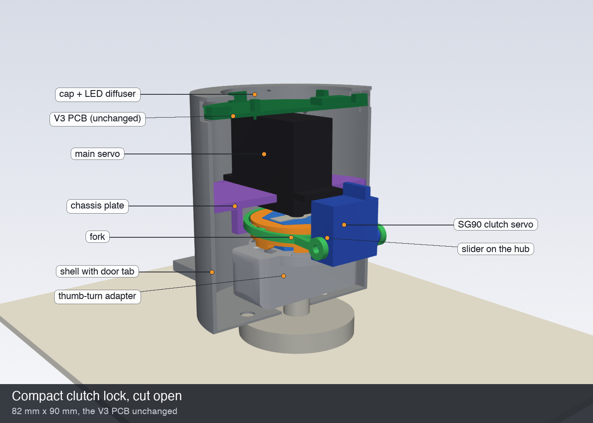
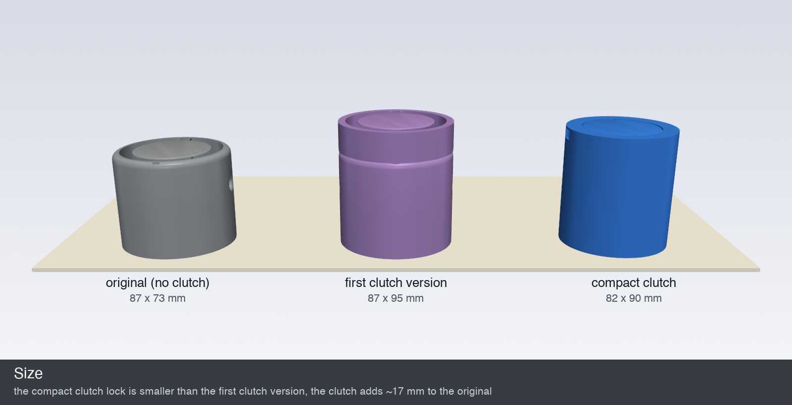
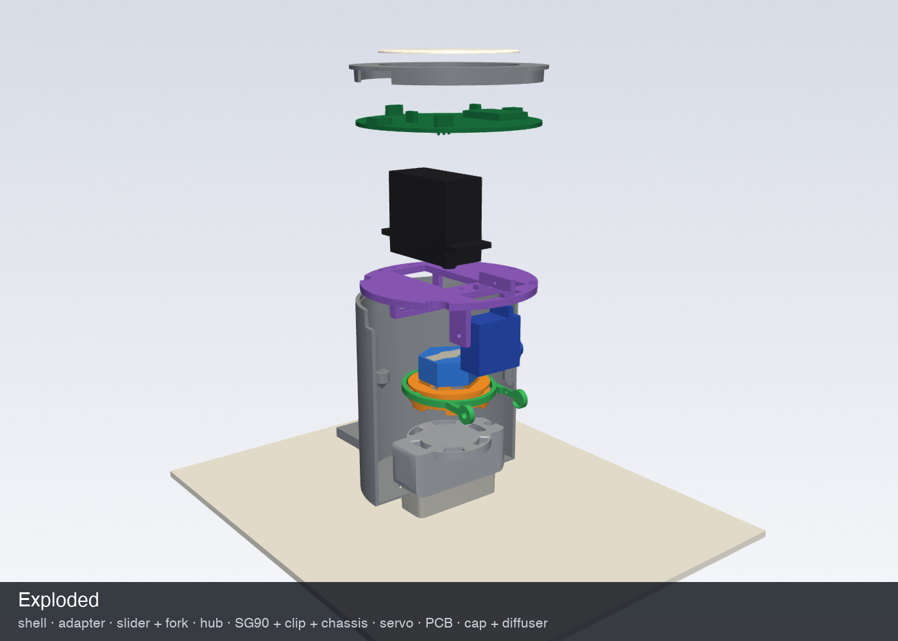

# 🔓 Compact clutch lock

A complete case for the smart lock with a **servo clutch**, built around the **unchanged V3 PCB**. In the original design the servo horn is screwed straight to the thumb-turn, so turning the key by hand means back-driving the servo's ~1:300 gearbox. Here a dog clutch sits between them, and a small SG90 servo closes it **only while the lock is moving**. The rest of the time the key and the thumb-turn turn freely, any number of turns, in either direction.




| | Original (no clutch) | First clutch version | **Compact clutch** |
| :-- | :-: | :-: | :-: |
| Size (diameter × height from the door) | 87 × 73 mm | 87 × 95 mm | **82 × 90 mm** |
| Printed case parts | 2 + diffuser | 2 + ring + 5 clutch parts | **8 + diffuser** |
| PCB | V3 | V3 | V3, unchanged |



The height depends on how far your thumb-turn sticks out (here 23.5 mm, see below). Most of the gain over the first clutch version comes from four changes:

- **Merged case:** a single shell replaces `bottom` + `middle` + the extension ring.
- **Shorter slider:** it rides on the *outside* of the hub (a hex prism) instead of on a separate shaft.
- **No separate dog flange:** the slots are cut into the adapter's own top, and its floor is thinner.
- **SG90 beside the clutch:** it hangs next to the clutch rather than adding height.

## Parts

| File | Print orientation (as exported) | What it does |
| :-- | :-- | :-- |
| `shell.stl` | floor down | The case. It keeps the original floor and door tab, and adds bosses for the chassis, ledges for the PCB, the USB opening and a **flexure side button** (a tongue in the wall that presses the PCB's switch). |
| `knob_adapter.stl` | slotted top down | The original thumb-turn pocket, a thinner floor, 6 chamfered dog slots, and a magnet hole. |
| `hub.stl` | top down | Hex prism. The straight servo horn sits in its top. |
| `slider.stl` | top flange down | 6 chamfered dog teeth and a groove for the fork. It slides 3.5 mm on the hub. |
| `fork.stl` | flat | Ring yoke whose pins ride in the slider groove. It pivots on the SG90 shaft and an M3 screw. |
| `chassis.stl` | plate down | Plate the main servo hangs from by its tabs, with a window for the SG90, the fork ear and the reed sensor holder. |
| `sg90_clip.stl` | on its side | Bridge over the SG90 window. The SG90's top tab screws to it. |
| `cap.stl` | outside down | Holds the PCB down. The original `cover_led.stl` diffuser drops into its window. |

Use PETG for the hub, slider, fork and adapter, and PETG or PLA for the rest, with 0.2 mm layers and 3-4 walls. Nothing needs supports. The only bridges are the slider groove and a few holes.

**Hardware:**
- MG996R (or another standard-size) servo plus its straight horn
- SG90 micro servo
- Reed switch (2.5 × 14 mm glass) and a 5 mm magnet
- Screws:
  - 4 × M2.5 for the servo tabs
  - 3 × M3 × 8 self-tapping for the chassis
  - 1 × M3 × 12 as the fork pivot
  - 2 × M2 × 6 for the SG90 clip
  - 1 × M2 for the SG90 tab
  - 4 × M2 × 12 self-tapping to fix the horn to the hub
  - 1 × M2 to fix the SG90 horn to the fork
- A dab of grease

## Measure your door first

```python
THUMBTURN_HEIGHT = 23.5   # lock.py: from the escutcheon (where the floor sits) to the top of the thumb-turn
```

Everything above the adapter is positioned from this number. Measure it within about ±0.5 mm and set it in `lock.py`, then regenerate (see below). The adapter's pocket is the original one, so it fits the same thumb-turn as before.

## Assembly

1. **Shell:** screw it to the door through the tab, as before.
2. **Adapter:** put the magnet in the adapter and push the adapter onto the thumb-turn. In the home position (where the key goes in and out) the magnet must point **up**, towards the door tab, so that it passes under the reed sensor.
3. **Servo:**
   - Cut the straight horn to **22 mm**, put it on the main servo and fix it with its centre screw.
   - Put the hub over the horn and screw it on from below with the four M2 self-tappers. Drill the pilot holes to match your horn.
   - Put the slider on the hub, teeth facing away from the servo.
   - Push the servo down through the chassis window and screw its tabs to the plate.
4. **SG90 and fork:**
   - Cut off the SG90's lower mounting tab.
   - Push the SG90 up through the window in the plate, shaft on the +x side, and screw its top tab to `sg90_clip`.
   - Screw the clip to the plate.
   - Screw the SG90's single-arm horn into the fork's +x arm and fit the fork pins into the slider groove.
   - Press the horn onto the SG90, then put the M3 pivot screw through the chassis ear into the fork's -x arm. The fork turns on this screw, so don't overtighten it.
5. **Reed:** press the reed switch into the holder on the chassis.
6. **Wiring:**
   - Route the servo, SG90 and reed wires up through the slots in the plate.
   - Clip the PCB's header pins short (to ~2 mm above the plastic) and solder the wires onto them.
   - The SG90 signal goes to the programming header's **RX pin** (GPIO3). SG90 + and − go to the servo's + and −.
7. **Into the case:** lower the chassis module into the shell and screw it to the three bosses.
8. **PCB:** lay the PCB on its ledges, with the USB socket facing the opening.
9. **Cap:** drop the diffuser into the cap and snap the cap on.

The PCB, the chassis module and the cap all go straight down the bore. The CAD checks this.

## Setting the clutch angles

In `code/smart_lock/smart_lock.ino`:

```cpp
#define USE_CLUTCH 1
#define CLUTCH_OPEN_ANGLE 75     // fork up, teeth out of the slots
#define CLUTCH_CLOSED_ANGLE 105  // fork down, a few degrees past contact so the SG90 keeps pushing
```

Swap the two angles if your SG90 is mounted the other way round. These are the only settings. The number of turns is learned on the first lock and the first unlock, as described in step 8 of the main README.

A movement goes:
1. close the clutch (350 ms)
2. turn until the reed sensor has seen the magnet the learned number of times
3. reverse for 40 ms to unload the teeth
4. open the clutch

## When the teeth don't line up

After the key has been used, the thumb-turn can stop at any angle. The teeth only seat fully within ±4° of a slot, and the 0.6 mm chamfers catch them up to about ±7° off.

1. The SG90 pushes the slider down. If the teeth land on the flat between the slots, the SG90 just keeps pressing.
2. The servo starts turning, and the teeth slide over the flat to the next slots. That takes at most ~51°. Then they drop in.
3. The servo turns the lock until the magnet has come round the learned number of times. Because it doesn't run for a fixed time, finding the slots doesn't shorten the turn.

`code/tests/motion/run.sh` simulates this for every offset from 0° to 59°. Each case locks fully and stops within ~6° of the home position.


## Verified in CAD

`python lock.py` (needs `pip install manifold3d trimesh`) regenerates every STL from the parameters and then runs `checks.py`:

* **Fit:** no two parts overlap with the clutch open, half closed or closed. The models include the servo, SG90, horns and PCB with its parts.
* **Motion:**
  - With the clutch open, the thumb-turn turns a full circle without touching anything.
  - The hub, horn and open slider turn a full circle on the servo.
  - With the clutch closed, the slider and adapter turn together.
  - The teeth seat only when they line up with a slot (±4°).
* **Assembly:** the adapter, the chassis module (chassis, clip, servo, hub, slider, fork and SG90), the PCB and the cap each go straight down the bore without hitting anything.
* **Clearances:**

  | Gap | mm |
  | :-- | --: |
  | Reed sensor to magnet | 1.25 |
  | SG90 to the turning adapter | 0.5 |
  | Fork to SG90 | 0.9 |
  | Fork to slider | 0.8 |
  | Teeth to adapter when open | 1.0 |
  | Tooth engagement when closed | 2.5 |
  | Servo to PCB | 2.0 |

* **Printability:** every part is checked for overhangs steeper than 45° in its print orientation. What's left is small: the bridge over the slider groove and the round fork bosses.



## Not verified

* **Door fit:** this uses the original floor and door tab, so it mounts the same way. The thumb-turn height is your measurement.
* **Bought-part dimensions:** the servo, SG90 and PCB parts are modelled from datasheet dimensions and the EasyEDA file. Check the servo's tab height (`SERVO_TAB_FROM_FACE`) and the side switch position (`BUTTON_NUB`) on your parts.
* **Strength:** loads and tolerances on a real printer still need a test print, especially the 0.3 mm sliding fits (`FIT`).
