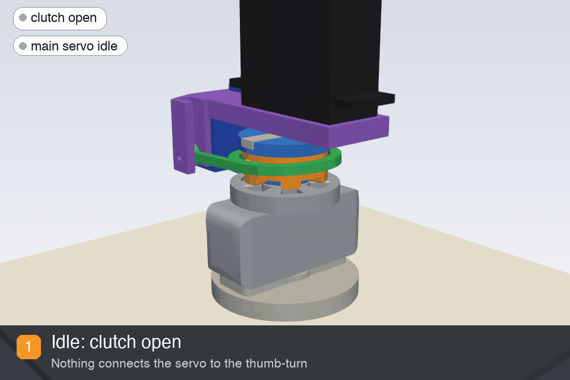
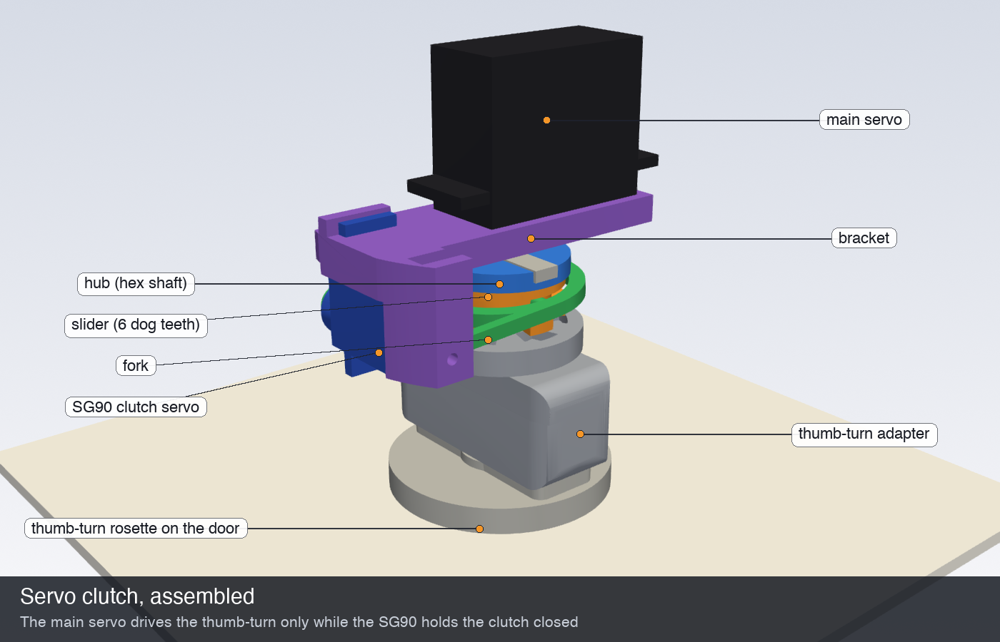
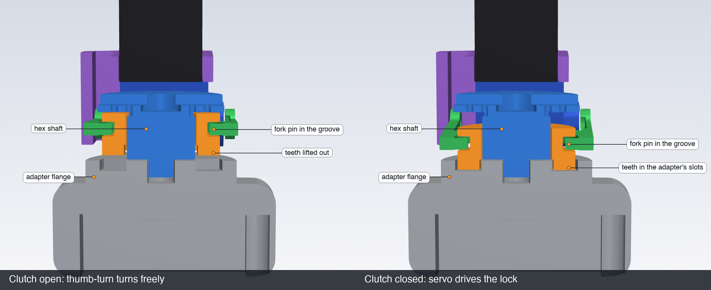
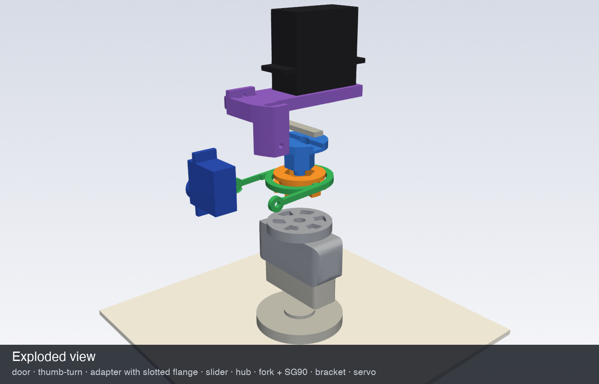

# 🔓 Servo clutch: use the key without fighting the servo

In the original design the servo horn is screwed straight to the thumb-turn adapter. Turning the key from outside, or the thumb-turn by hand, means back-driving the servo's ~1:300 gearbox. That is hard work and wears the gears.

The clutch decouples them. A small dog clutch sits between the servo and the thumb-turn, and a second micro servo (SG90, ~1.5 €) closes it **only while the lock is moving**. The rest of the time the thumb-turn spins freely, any number of turns in either direction, so it works with euro cylinders that need full 360° key turns.









| Part | Print | Notes |
| :-- | :-- | :-- |
| `knob_adapter_clutch.stl` | as exported, flange down | the original thumb-turn adapter with its horn pocket filled and a 6-slot dog flange added |
| `clutch_hub.stl` | disc down | screws to the servo horn, hex shaft + centring pin |
| `clutch_slider.stl` | as exported | slides on the hex, 6 dog teeth, groove for the fork |
| `clutch_fork.stl` | flat | ring yoke, two pins ride in the slider groove |
| `clutch_bracket.stl` | as exported | slips over the main servo body (standard 40 × 20 mm), holds the SG90 and the fork pivot |
| `extension_ring.stl` | flat | spacer between `bottom` and `middle`: the servo sits ~22 mm further out now |

PETG is recommended for the hub, slider and adapter. Use 4 walls and 40 % infill.

**Hardware:** SG90 micro servo, 1 × M3 × 12 screw (fork pivot), 2 × M2 self-tapping screws (horn to hub), 1 × M2 self-tapping screw (SG90 horn to fork), a dab of grease on the hex and the groove.

## Assembly

1. Shorten the main servo's straight horn to **30 mm** total length so it fits the hub's slot. Screw the hub to it with two M2 screws through the horn holes. The hub has pilot holes at 7.5 mm and 11 mm, so drill to match your horn.
2. Slide the bracket band over the output end of the main servo. The SG90 cradle goes on the side where the output shaft is **closest** to the end of the servo body. Secure it with a drop of CA glue.
3. Put the slider on the hub's hex, teeth facing away from the servo.
4. Push the SG90 into its cradle, shaft facing the same way as the main servo's shaft, and screw its top tab to the bracket.
5. Cut the SG90's single-arm horn to fit the pocket in the fork's +x arm and screw it to the fork. Fit the fork's pins into the slider groove, press the horn onto the SG90 spline, and put the M3 screw through the bracket ear into the fork's other arm (the fork pivots on it, so don't overtighten).
6. Print `extension_ring.stl` and put it between the `bottom` and `middle` parts.
7. Wiring:
   * **V3 board (USB):** SG90 signal goes to the **RX pin of the programming header** (GPIO3; the firmware switches Serial to TX only). SG90 + and − connect to the main servo's + and − (a Y cable or a soldered splice).
   * **V4 board (battery):** SG90 goes to the clutch header J2.

## Calibration

In `smart_lock.ino`:

```cpp
#define USE_CLUTCH 1
#define CLUTCH_OPEN_ANGLE 75     // fork lifted, dogs apart
#define CLUTCH_CLOSED_ANGLE 105  // fork pressed down, a few degrees past contact
```

Depending on which way your SG90 is mounted, the two angles may be swapped. Check with the thumb-turn:

* **Open:** the thumb-turn turns freely all the way round.
* **Closed:** the slider's teeth are fully in the adapter's slots. Go a few degrees past the point where they bottom out, so the SG90 keeps pushing. If the teeth land tooth-on-tooth, the main servo starts turning anyway and they drop in within 60°.

Then run the normal lock / unlock calibration (hold the side button while powering on). The clutch closes automatically for it.

A movement now runs: close the clutch (350 ms) → turn → reverse the servo for 40 ms to unload the dog teeth → open the clutch.

## Changing the design

Everything is generated by [`clutch.py`](clutch.py) (`pip install manifold3d trimesh`, then `python clutch.py`). It also runs a collision check over the full fork, slider and thumb-turn range. The main parameters are the servo body size (`SERVO_BODY`, `SERVO_SHAFT_FROM_END`), the clutch travel and teeth, and the fork pivot distance.

The fit against the existing `bottom` / `middle` parts was checked against their 80 mm bore. The exact height of the extension ring depends on how deep your servo originally sat (`ORIGINAL_FACE_GAP`), so check it on your build before printing it.
