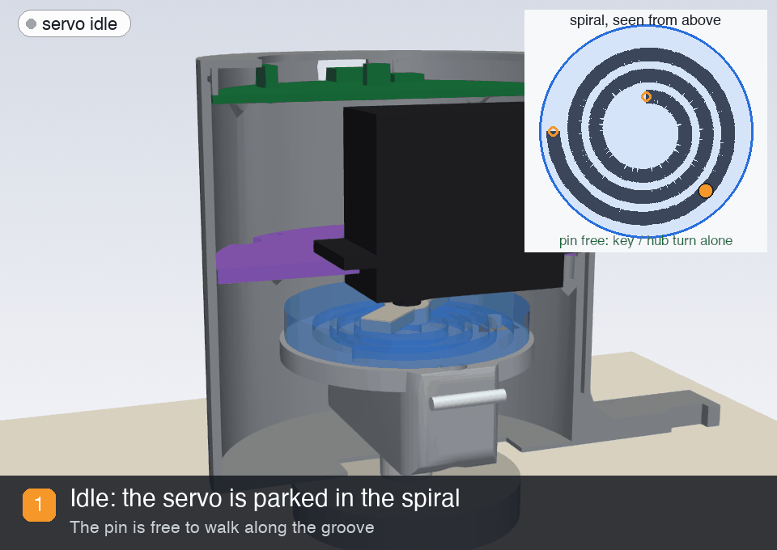
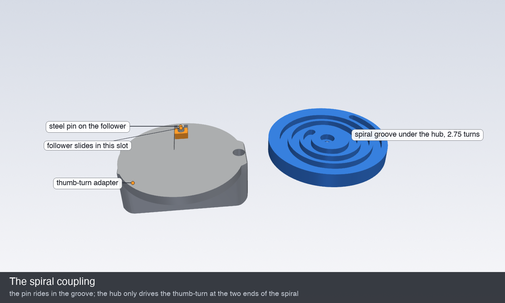

# 🌀 Single-servo lock with a spiral coupling

The key and the thumb-turn turn freely, with **one servo**. There is no clutch servo and nothing to engage or calibrate, and the **V3 PCB is unchanged**.

## The idea

Under the servo hub is a **spiral groove of 2.75 turns**. A small block slides in a radial slot in the thumb-turn adapter, and a steel pin on the block rides in that groove.

* **Inside the spiral, hub and thumb-turn are not connected.** Turning the key only walks the pin along the groove, with the block sliding in its slot. The servo doesn't move, and you feel nothing except a little friction.
* **At either end of the spiral, the pin is blocked**, and the hub drives the thumb-turn.
* **After every movement the servo backs off into the spiral.** It turns back by the number of turns it just drove plus a bit, so the key can undo that movement by hand. A €0.20 hall sensor that sees a magnet in the hub tells the firmware how far it has gone.

## Options considered

The lock is a euro cylinder: one lock or unlock is one or two **full** turns of the key. That rules out most tricks.

| Idea | Result |
| :-- | :-- |
| Lost-motion slot: a positional 180° / 270° servo parks in the middle of a slot | ✗ A slot gives less than 360° of free play, and the key needs at least 360°. |
| Direction-sensing clutch (Bendix or V-ramp with a friction drag) | ✗ There is no reliable way to make it let go again afterwards. |
| Back-drivable drive: gimbal BLDC direct drive, low-ratio gear motor | ✗ About 0.2 N·m against the ~1 N·m a lock needs, and it needs a motor driver the PCB doesn't have. |
| Smart / bus servo with its torque switched off | ✗ The ~1:300 gearbox still can't be turned from the output. |
| Travelling nut: multi-turn lost motion along a thread | Works, but needs 10+ mm more height, and a nut can wedge against its stop. |
| SG90 clutch servo (branch `feature/clutch`) | Works, but needs a second servo, a fork, angle calibration and +4.5 mm of height. |
| **Spiral coupling + continuous servo + hall sensor** | ✓ **Chosen.** One servo, nothing to engage, smallest case, cheapest. |
| Spiral coupling + multi-turn "sail winch" positional servo | ✓ Possible. It needs no hall sensor, because the servo knows its own position. But winch servos cost €25-45, and they need a range of 2 × turns + 0.5, i.e. 4.5 turns for a two-turn lock. The mechanics here would work unchanged. The firmware for it isn't written. |

| | Original | Compact clutch | **Single servo + spiral** |
| :-- | :-: | :-: | :-: |
| Size | 87 × 73 mm | 82 × 90 mm | **82 × 85 mm** |
| Motors | 1 servo | 2 servos | **1 servo** |
| Key turns freely | ✗ | ✓ | ✓ |
| One-time settings | run times | 2 clutch angles | **none** |
| Printed parts | 2 + diffuser | 8 + diffuser | **6 + diffuser** |

## Parts

| File | Print (as exported) | What it does |
| :-- | :-- | :-- |
| `shell.stl` | floor down | The case. It keeps the original floor and door tab, and adds chassis bosses, PCB ledges, the USB opening and a flexure side button. |
| `knob_adapter.stl` | slotted top down | The original thumb-turn pocket, a thinner floor, the radial slot for the follower, and a magnet hole. |
| `follower.stl` | flat | The 5.8 × 4.6 × 2.9 mm block that slides in the slot. The pin is pressed into it. |
| `hub.stl` | horn side down | The spiral groove (2.75 turns, 5 mm pitch) and a pocket for the servo horn. |
| `chassis.stl` | plate down | The plate the servo hangs from by its tabs, the knob reed holder and the hall sensor arm. |
| `cap.stl` | outside down | Holds the PCB down and takes the original `cover_led.stl` diffuser. |

Use PETG for the hub, follower and adapter, and PETG or PLA for the rest, with 0.2 mm layers. Nothing needs supports.

**Parts to buy:**
- **Servo:** MG996R **360° (continuous rotation)**, the same type as before, plus its straight horn cut to 30 mm.
- **Hub sensor:** A3144 hall switch and a 3 × 2 mm magnet.
- **Knob sensor:** reed switch (2.5 × 14 mm) and a 5 × 3 mm magnet, as before.
- **Pin:** a **3 × 6 mm steel dowel pin**, or a piece of 3 mm steel rod.
- **Screws:**
  - 4 × M2.5 for the servo tabs
  - 3 × M3 × 8 self-tapping for the chassis
  - 1 × M3 × 12 to hold the hub and horn on the spline

The SG90, fork, clip and their screws are gone.

## Wiring

All of it goes to the existing V3 PCB.

| Part | PCB |
| :-- | :-- |
| Main servo | servo header H2, as before |
| Knob reed | reed header, as before (GPIO13) |
| **A3144 hall sensor** | VCC → 5 V (servo +), GND → servo −, **OUT → RX pin of the programming header** (GPIO3). It is open collector, and the firmware turns on the internal pull-up. |

## Assembly

1. **Shell:** screw it to the door through the tab, as before.
2. **Adapter:**
   - Press the pin into the follower, with 2.4 mm sticking out, and drop the follower into the adapter's slot, pin up.
   - Put the 5 × 3 mm magnet into the adapter's magnet hole.
   - Push the adapter onto the thumb-turn so that, at home, the magnet faces the reed (+x, towards the side button).
3. **Hub:**
   - Put the cut horn on the servo spline.
   - Push the 3 × 2 mm magnet into the hub's top face, **south pole up** (the A3144 only reacts to a south pole).
   - Put the hub over the horn, horn in the pocket, groove facing the door. Clamp both onto the spline with the M3 screw from the groove side.
4. **Chassis:**
   - Push the servo down through the chassis window and screw its tabs on.
   - Glue the A3144 into its pocket in the arm (flat face down, towards the hub) and the reed into its holder on the leg.
5. **Into the case:** lower the chassis module into the shell. If the hub sits on the pin, turn the thumb-turn a little until the pin finds the groove and the module drops in. Screw it to the three bosses.
6. **PCB and cap:** lay the PCB on its ledges, drop the diffuser into the cap and snap the cap on.

Where the pin lands in the spiral doesn't matter. The first lock and unlock take up whatever free play there is.

## Firmware

Nothing to set. The first lock and the first unlock turn until the thumb-turn hits its end stop (the hub sensor sees the hub stop) and learn the number of turns from the knob reed.

After that, every movement goes:
1. **Drive:** the servo takes up the free play, then turns the thumb-turn until the knob reed has seen the magnet the learned number of times. The thumb-turn ends at its home position.
2. **Park:** the servo turns back the learned number of turns + 1 hub-magnet passes, about 2.4 turns for a two-turn lock. That leaves room in the spiral for the key to undo the movement.

If the hub stops turning before the movement completes (handle not lifted, bolt blocked), the lock reports **jammed** and still parks, so the key keeps working.

`code/tests/motion/run.sh` simulates the lock: the spiral free play, the end stops, both sensors, key use by hand and jams. It checks:
- learning the turns
- 300 random mixed motor and key operations, where every motor move ends at home and the key never has to turn the servo
- jams
- one-turn locks
- every possible starting position of the pin after assembly

## Verified in CAD

`python lock.py` regenerates the STLs and runs `checks.py`:

* **Fit:** no two parts overlap at the start, middle and end of the spiral. The servo, horn, sensors and PCB are modelled.
* **Spiral:**
  - The pin runs clear in the groove at 45 points along all 2.75 turns.
  - It is **blocked** 15° past either end, which is what makes the hub drive.
  - The walls between the turns are 1.6 mm.
* **Motion:**
  - From the parked position the key turns the thumb-turn **two full turns** by hand without hitting anything, and the pin stays clear in the groove.
  - The hub turns through the whole spiral without touching anything.
* **Assembly:** the adapter with the follower, the chassis module, the PCB and the cap each go straight down the bore.
* **Sensors:**
  - The hub magnet reaches the hall sensor **134°** after reversing from either end of the spiral. The firmware simulation assumes 135°.
  - Knob magnet to reed: 2.9 mm. Hub magnet to hall sensor: 1.6 mm.
  - Each magnet stays at least **14 mm** from the other sensor, so the two pairs don't trigger each other.
* **Printability:** overhangs are reported per part. What remains is the horn pocket bridge in the hub and small holes.

**Rough strength:** at the stall torque of an MG996R (~1.1 N·m), the pin load at the inner end of the spiral (r = 8 mm) is about 140 N. On a 3 mm steel pin over the 2.3 mm it sits in the groove, that is ~20 MPa of bearing stress on PETG (yield ~50 MPa). On the follower block in its slot it is ~10 MPa.

## Not verified

* **Door fit:** the thumb-turn height (`THUMBTURN_HEIGHT`, 23.5 mm) is your measurement. Change it and rerun `lock.py`.
* **Bought-part dimensions:** the servo tab height, side switch position, reed and hall sensitivity at these gaps, and the exact parts are modelled from datasheets.
* **Real-world behaviour:** wear, friction and print tolerances (0.2-0.3 mm fits) need a test print.

