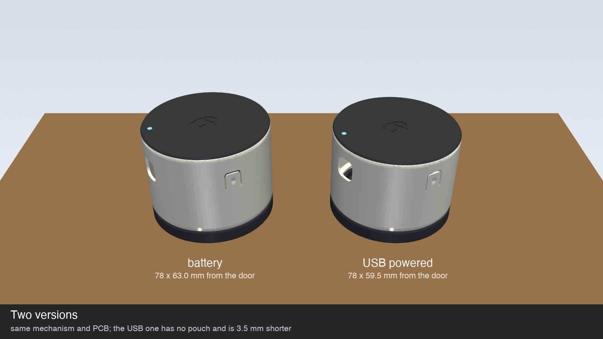

# v5 part list (AliExpress)

Everything for one lock, in two versions. Every link is a specific listing, checked on AliExpress Hungary on 2026-10-27. **Pick the variant in the "Choose" column**: most listings sell many sizes under one link. Prices are the listing's price in HUF on that day and change often. Most items come in packs, so one order leaves spares.

| | Battery | USB powered |
| :-- | :-- | :-- |
| Height from the door (rosette door) | 63.0 mm | 59.5 mm |
| Power | 1200 mAh pouch, charged over USB-C | USB-C cable to a wall charger |
| Thread network | sleepy end device (polls every 2 s) | router: also strengthens your Thread network |
| Prints that differ | `case_battery.stl`, `light_pipe_battery.stl` | `case_usb.stl`, `light_pipe_usb.stl` |
| PCB assembly BOM | `PCB/v5/fab/bom_battery.csv` | `PCB/v5/fab/bom_usb.csv` |
| Firmware | `idf.py build` | `idf.py -B build_usb -D SDKCONFIG=build_usb/sdkconfig -D SDKCONFIG_DEFAULTS="sdkconfig.defaults;sdkconfig.defaults.usb" build` |

## Both versions

| # | Part | Qty | Choose | Listing | Price |
| :-: | :-- | :-: | :-- | :-- | --: |
| 1 | N20 gearmotor, metal gearbox | 1 | **Speed (RPM): 1000**, **Voltage: 6V** | [GA12-N20 metal gear motor](https://www.aliexpress.com/item/1005010285600111.html), 4.9★, 10 000+ sold | HUF 1 533 |
| 2 | Worm gear set 1:40, module 0.5 (steel 40T wheel + brass worm) | 1 set | **Number of Teeth: 40 Teeth-6mm**, **Hole Diameter: A Worm-3mm** | [1:40 steel worm gear 0.5M 40T](https://www.aliexpress.com/item/1005008008683119.html) | HUF 2 683 |
| 3 | Stainless rod Ø 6 mm (hub axle, cut to 22.5 mm) | 1 | **Diameter: 6mm**, **Length: 100mm** | [303 stainless linear shaft](https://www.aliexpress.com/item/1005006293171727.html), 4.8★, 10 000+ sold | HUF 294 |
| 4 | Dowel pins Ø 2 × 8 mm (wheel → hub) | 2 | **Diameter: 50 Pieces M2**, **Length: 8mm** | [304 stainless cylindrical pins](https://www.aliexpress.com/item/1005009385154332.html), 4.9★, 2 000+ sold | HUF 855 |
| 5 | Dowel pin Ø 3 × 5 mm (spiral follower) | 1 | **Diameter: 30 Pieces M3**, **Length: 5mm** | same listing as #4 | HUF 855 |
| 6 | Magnet N52 disc 5 × 2 mm, axial (thumb-turn) | 1 | **Color: N52 NdFeB D5x2mm**, **Size: 10PCS** | [N52 disc magnets, standard (axial)](https://www.aliexpress.com/item/1005010805304468.html), 4.9★, 4 000+ sold | HUF 2 702 |
| 7 | Magnet N52 disc 3 × 2 mm, axial (hub) | 1 | **Color: N52 NdFeB D3x2mm**, **Size: 10PCS** | same listing as #6 | HUF 2 702 |
| 8 | Heat-set insert M3 × 3 × 4.2 (jaw walls) | 2 | **Size: M3xL3xOD4.2**, **Color: 100PCS** | [brass heat-set inserts](https://www.aliexpress.com/item/1005006838108683.html), 4.9★, 10 000+ sold | HUF 1 688 |
| 9 | M3 × 16 socket head screw (jaws) | 2 | **Size: M3(55pcs)**, **Length: 16mm**, **Color: Stainless (DIN912)** | [304 stainless socket / button head screws](https://www.aliexpress.com/item/1005006999030038.html), 4.9★, 10 000+ sold | HUF 1 391 |
| 10 | M3 × 8 button head screw (case lock) | 1 | **Size: M3(55pcs)**, **Length: 8mm**, **Color: Stainless (ISO7380)** | same listing as #9 | HUF 1 391 |
| 11 | M2 × 5 self-tapping pan head (deck) | 3 | **Size: M2 (100pcs)**, **Length: 5mm** | [304 stainless self-tapping screws](https://www.aliexpress.com/item/1005008675268703.html), 4.9★, 2 000+ sold | HUF 469 |
| 12 | JST SH 1.0 mm 2-pin plug with wires (motor; battery too in the battery version) | 1-2 | **Color: 10CM**, **Package: 10PCS**, **Connector Type: Single head**, **Pins: 2P** | [JST SH1.0 pre-crimped cables](https://www.aliexpress.com/item/1005007277314092.html), 4.9★, 1 000+ sold | HUF 699 |
| 13 | 3M VHB 5952 tape, 1.1 mm | ~1 m | **Color: Width 10mm**, **Length: 3M**, **Thickness: 1.1mm** | [3M 5952 VHB](https://www.aliexpress.com/item/1005011601262596.html), 4.8★, 5 000+ sold | HUF 1 287 |
| 14 | PETG filament: white (case) + black (base, cap, inner parts) | ~60 g + ~70 g | **Color: PETG White** and **PETG Black** | [Geeetech PETG 1 kg](https://www.aliexpress.com/item/1005002374895224.html), 4.8★, 10 000+ sold, ships without import charges | HUF 3 502 / kg |
| 15 | Clear filament for the light pipe | 1 g | **Color: PLA Transparent** | same listing as #14 | |

> **#13, the tape:** this is a third-party seller, not 3M's own store. Fake "3M VHB" is common, and the tape is the only thing holding the lock to the door. If the roll isn't clearly the real thing, buy 5952 or 4910 from a local hardware or car-parts shop. Stick it on the base ring as short straight pieces, about 20 mm long, edge to edge. Bending one strip round the ring makes it wrinkle.

## Battery version only

| # | Part | Qty | Choose | Listing | Price |
| :-: | :-- | :-: | :-- | :-- | --: |
| 16 | Li-ion pouch 603450, 3.7 V, 1200 mAh, with protection board | 1 | **Color: 603450-1200mAh 1PCS** | [603450 1200 mAh Li-Po](https://www.aliexpress.com/item/1005006955861075.html), 4.8★ | HUF 2 756 |

Cut off its plug and crimp or solder on a JST SH lead (#12): red to pin 1 (VBAT), black to pin 2 (GND). Check the polarity against the board before plugging it in. Keep the protection board on the cell.

## USB version only

| # | Part | Qty | Choose | Listing | Price |
| :-: | :-- | :-: | :-- | :-- | --: |
| 17 | USB-A to right-angle USB-C cable | 1 | **Color: WHITE** (or black), **Length: 3m** | [right-angle USB-C cable](https://www.aliexpress.com/item/1005009007731735.html), 4.9★, 900+ sold | HUF 959 |
| 18 | 5 V 2 A USB wall charger | 1 | **Plug Type: White EU** | [5 V 2 A USB charger](https://www.aliexpress.com/item/1005010044221239.html), 4.9★, 5 000+ sold | HUF 1 298 |

The right-angle plug lies flat along the case, and the case's opening (12.8 × 7 mm) fits a standard USB-C moulding. In the USB version the PCB gets **R13** (0 Ω) and no charger or battery connector. **Never fit R13 on a board with a battery:** it would put 5 V straight on the cell.

## PCB

Not from AliExpress. Order it assembled from [JLCPCB](https://jlcpcb.com) (or PCBWay). Upload everything from `PCB/v5/fab`: the Gerbers and drill file, `pick_and_place.csv`, and **`bom_battery.csv` or `bom_usb.csv`**. The board is the same for both; the BOM decides the version, and the assembler only places the parts in that BOM. It has 0402 parts, a TSSOP-16 and a module with a centre pad, so it isn't a hand-soldering job, and loose chips from AliExpress are often fakes.

## Worm gear set notes

* **Steel 40T wheel**, Ø 21 mm, 6 mm bore, with a set-screw boss. The boss faces up, toward the deck, and its set screw holds the wheel on the 6 mm axle.
* **The torque goes through the two 2 × 8 mm dowels**, not the set screw. Slip the printed `wheel_drill_jig` over the boss and drill two 2.2 mm holes through the toothed ring. The steel is ordinary carbon steel: use a sharp HSS bit and a little oil. Then press the dowels through the wheel into the hub.
* **The brass worm** has a set screw onto the N20's 3 mm D-shaft. The printed end bearing on the deck puts a pin into the worm's free end and takes its thrust.
* With the 1000 RPM motor the drive is 1200:1 and gives up to ~0.96 N·m at the thumb-turn. The tooth stress is 122 of 200 MPa in `checks.py`.

**Measure before printing the hub and deck.** The wheel's boss (about Ø 11 × 4.5 mm) and ring (about 3.5 mm thick) come from the seller's photos. Set yours in `WHEEL` in `3D printed case/v5/lock.py` and run `python lock.py`: it moves the deck if needed, re-exports the STLs and re-runs the checks.

## Printing

PETG, 0.2 mm layers, 3 walls. Every STL is already in its print orientation, and none needs supports (`checks.py` checks this).

* **Two-tone look:** print the case in white, and the base and cap in black (anthracite). The V-grooves where the parts meet are meant to show.
* **Clear light pipe:** print it in transparent PLA or PETG.
* **Debossed padlock:** it is on the cap's top face, which prints on the bed. A textured PEI sheet gives it a nice matte finish.
