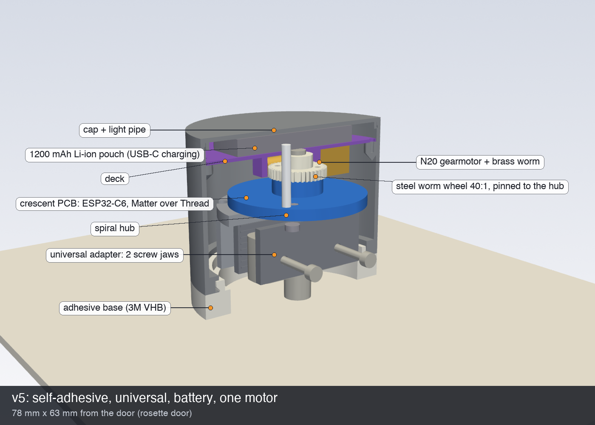
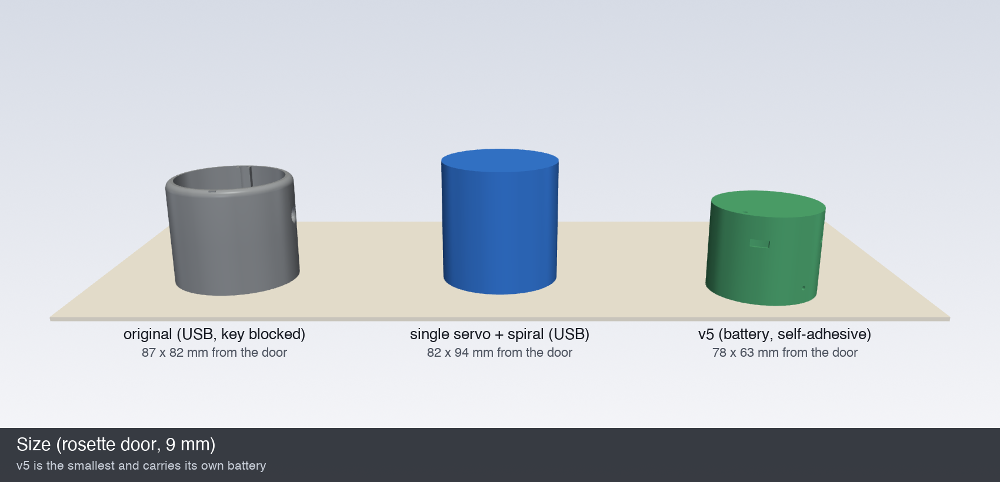
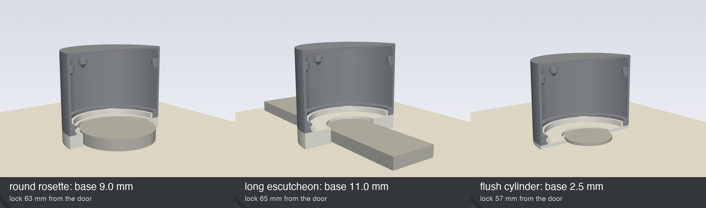
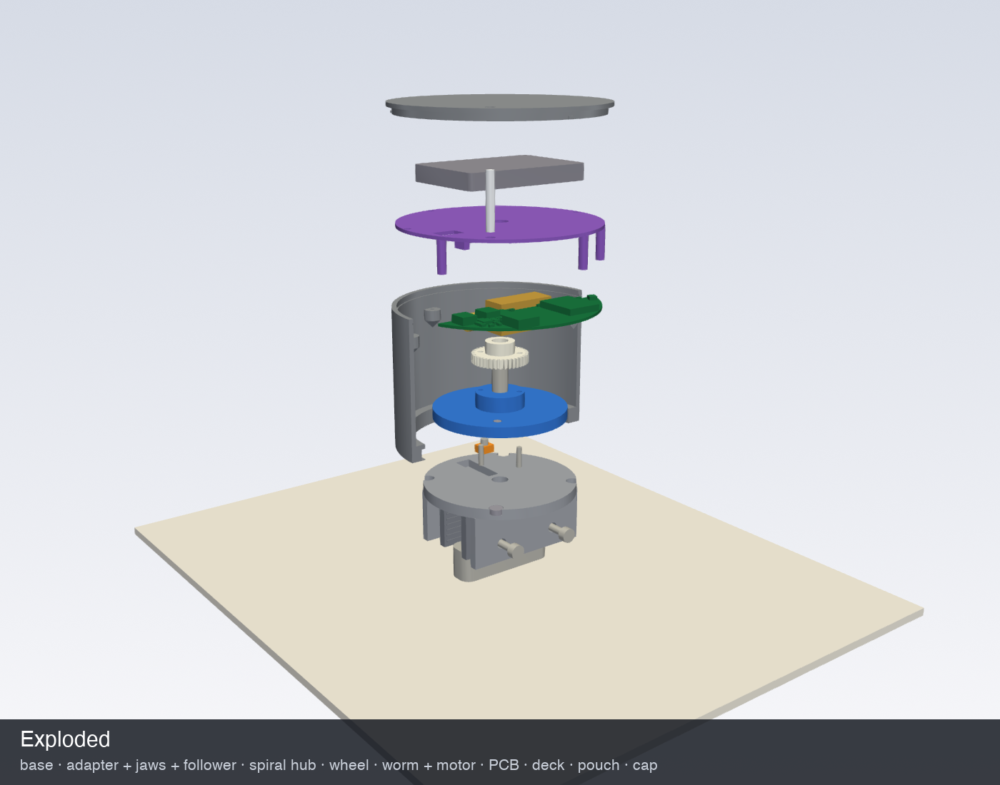
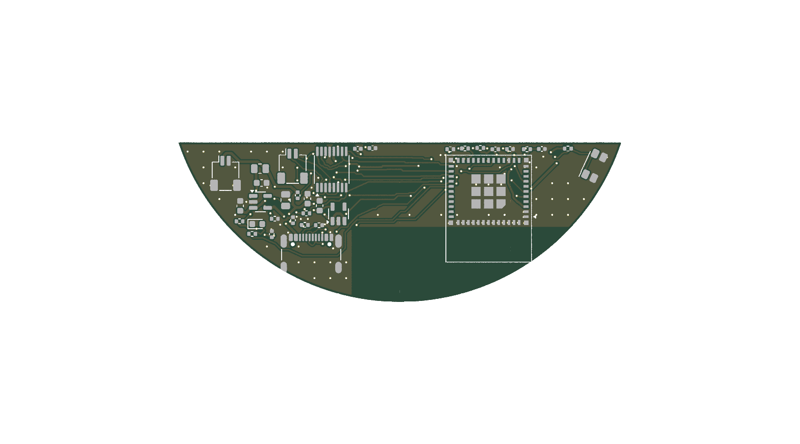

# v5: self-adhesive, universal, battery powered

A clean-sheet lock, designed end to end: mechanics, PCB and firmware. It sticks to the door with 3M VHB tape, fits most thumb-turn cylinders, runs on a rechargeable pouch cell and shows up as a native **Matter door lock** (Apple Home, Google Home, SmartThings, Home Assistant). The key always turns freely, thanks to the spiral coupling from the single-servo branch.

| | Where |
| :-- | :-- |
| Mechanics (parametric CAD, STLs, checks, renders) | [`3D printed case/v5`](../3D%20printed%20case/v5) |
| PCB (generated in KiCad 9, routed, DRC, Gerbers, BOM, pick and place) | [`PCB/v5`](../PCB/v5) |
| Firmware (ESP32-C6, ESP-IDF 5.5 + esp-matter 1.6) | [`code/v5`](../code/v5) |
| Motion logic, shared with the V3 firmware and its simulation | [`code/smart_lock/motion.h`](../code/smart_lock/motion.h), [`code/tests/motion`](../code/tests/motion) |



## In one table

| | Single servo + spiral (USB) | **v5** |
| :-- | :-- | :-- |
| Size | 82 × 85 mm + the door's escutcheon | **78 × 63 mm from the door** (rosette door; 56 mm on a flush cylinder) |
| Mounting | door tab, screws | **self-adhesive base, nothing screwed to the door** |
| Fits | one thumb-turn shape (printed adapter) | **wings 4-22 mm thick, up to 46 mm long, 12-22 mm tall; home up / down / left / right** |
| Power | USB cable | **1200 mAh Li-ion pouch, USB-C charging** |
| Drive | MG996R 360° servo | **N20 30:1 gearmotor + brass worm + steel 40T wheel** (module 0.5), self-locking, current-limited |
| Free key | spiral coupling | spiral coupling (same geometry, 2.75 turns) |
| Sensors | knob reed + hub hall | two DRV5032 hall switches (~1 µA together) |
| Radio / smart home | ESP8266 Wi-Fi, HTTP / MQTT | **ESP32-C6, Matter over Thread** |
| Mass | | about 133 g (tape holds 22 cm² ≈ 7 N·m) |



## How it goes on the door

1. **Pick the base preset** for your door (`base_rosette`, `base_escutcheon` or `base_flat`). The base is a ring that clears the rosette or escutcheon and gives the tape a flat surface on the door leaf.
2. **Stick the base.** The `install_jig` drops into the base and over the thumb-turn wing, so the base is centred on the cylinder axis while the VHB tape sets (press 30 s, wait 24 h before full load).
3. **Clamp the adapter** onto the wing with its two M3 screw jaws. The `height_gauge` holds it at the right height while you tighten. Put the 5 × 2 mm knob magnet in the pocket that matches the thumb-turn's home position (up, down, left or right).
4. **Twist the case on.** The case slides down over the adapter and locks onto the base with a 25° bayonet. An M3 screw through the side stops it from turning back.
5. **Plug in the pouch, snap the cap on**, pair it in your home app.



## Inside



Bottom to top: base, adapter with jaws and follower, spiral hub with the steel worm wheel (on two steel dowels, around a 6 mm steel axle), the drive layer (N20 motor + worm beside the hub, the crescent PCB around it), deck, pouch, cap.

* **Spiral coupling.** The adapter's follower pin runs in a 2.75-turn spiral groove under the hub. The hub only pushes the thumb-turn at the ends of the spiral, so the key turns freely everywhere else. After every move the motor parks the pin back in the middle. This is the verified geometry from `3D printed case/spiral`.
* **Worm drive.** The worm can't be back-driven, so nothing holds the motor still. The DRV8833's current limit (1.33 A) caps the torque at the thumb-turn to about 0.96 N·m. The worm sits between the gearbox face and a printed end bearing, so those take its thrust, not the motor's output bushing.
* **Sensors.** A hall switch on the PCB's underside counts the thumb-turn magnet, which tells the firmware when the door is locked or unlocked, and also counts manual key turns. A second hall switch counts a magnet in the hub, for parking and stall detection. The firmware learns how many turns the lock needs.
* **Electronics.** The ESP32-C6-MINI-1 sits at the board edge with its antenna clear of copper. Around it: DRV8833 (both bridges in parallel), MCP73831 charger, RT9080 LDO, USB-C, a button and an LED with a light pipe. 37 parts, all SMD, both sides.

## The PCB



A half-disc board, 1.0 mm thick and 2 layers, beside the hub in the drive layer. The ESP32-C6 module sits on the right with its antenna in a copper-free corner. Power, the charger, the motor driver and USB-C are on the left. The two hall switches are on the underside, above their magnets.

Everything is generated from [`layout.py`](../PCB/v5/layout.py) (outline, fixed parts, GPIOs, shared with the CAD) and [`netlist.py`](../PCB/v5/netlist.py) (parts, MPNs, pads to nets):

```bash
cd PCB/v5    # in a KiCad 9 container (pcbnew + kicad-cli)
python3 erc.py && python3 make_board.py place && python3 make_board.py route && python3 make_board.py finish
```

`router.py` is a small 2-layer grid router written for this board, using negotiated congestion. Every net, ground included, is routed as tracks, so the ground pours are a bonus, not a dependency. Freerouting would be the usual tool, but it wasn't available here. Python's hashing randomises it slightly, so track shapes differ between runs. Most runs converge in 10-15 iterations. One stopped at 40 with three motor-driver nets left; the limit is now 80. If `route` reports failed nets, run `place` and `route` again. `finish.py` pours ground on both layers, runs KiCad's DRC and writes the Gerbers, drill file, BOM and pick-and-place to `fab/`. The latest board has about 2100 track segments and 190 vias, about 90 of them ground stitching.

## Battery life (estimated, not measured)

| | per day |
| :-- | :-- |
| 6 movements × ~28 s (drive + park) × ~0.3 A | ~14 mAh |
| ESP32-C6 as a Thread sleepy end device, 2 s poll, light sleep (~0.3 mA average) | ~7 mAh |
| Halls, LDO, charger, battery divider | < 0.2 mAh |
| **Total** | **~21 mAh** |

With ~1000 mAh usable that is **about 7 weeks** at 6 movements a day, and about 5 weeks at 10. Each movement costs as much as about a third of a day idle, so the number of movements decides most of it. Charging is through USB-C on the side of the case.

The firmware is built for this: the ESP32-C6 is a Thread **sleepy end device** (Matter ICD) and sleeps between polls. The idle current itself is an estimate until it is measured on a board. The 2 s poll interval is the main knob. A lock command waits at most that long in the Thread router. A longer interval saves battery, and a shorter one makes the lock answer faster.

## Firmware

[`code/v5`](../code/v5) is an ESP-IDF 5.5 project with esp-matter 1.6 from the Espressif component registry:

* Matter **door lock** endpoint (deadbolt) with a **power source** cluster for the battery level.
* Lock / unlock commands from any Matter controller. Key turns by hand are reported (source "manual"). A **LockJammed** alarm is sent when the hub stalls before the end.
* **Low power.** Thread runs as a minimal end device (MTD) with the Matter ICD server: 2 s slow poll, 0.5 s fast poll after activity. Automatic light sleep and tickless FreeRTOS run between polls, and the 802.15.4 radio and BLE sleep too. BLE is only used for commissioning, and there's no Wi-Fi. The main task blocks until the button or the thumb-turn hall changes level (GPIO wake), a Matter command arrives, or the 10-minute battery report is due. While the motor runs, a PM lock keeps the CPU awake.
* Button: short press locks or unlocks; hold 6 s to forget the learned turns; hold 12 s to factory reset (leaves the Matter fabric). The pairing QR code and manual code are printed on the serial port at boot.
* `motion.h` is the same controller as V3: drive until the thumb-turn arrives, park the pin back in the spiral, learn the turns, detect jams. `MOTION_DEFAULT_REV_MS` is now overridable, because the worm turns the hub in ~4-5 s instead of 1.2 s (v5 sets 6000 ms).
* Two OTA slots of 1.875 MB on the 4 MB module (the image is 1.55 MB), so Matter OTA updates work.
* It uses esp-matter's **test** attestation (test vendor ID). Home apps pair it with an "uncertified accessory" warning. That's normal for a DIY Matter device.

```bash
cd code/v5
idf.py set-target esp32c6 && idf.py build flash monitor   # ESP-IDF 5.5, e.g. in the espressif/idf:v5.5.3 container
```

## What was checked, and how

| Check | Tool | Result |
| :-- | :-- | :-- |
| Every pair of parts, 3 door presets × spiral start / middle / end | `checks.py` (manifold3d) | no overlaps |
| Spiral: the pin runs clear over 2.75 turns, is blocked 15° past both ends, walls ≥ 1.2 mm | `checks.py` | OK, 1.6 mm walls |
| The key turns two full turns with the motor parked; the hub sweeps the whole spiral | `checks.py` | OK |
| Universal range: 18 wing sizes, 4 home positions | `checks.py` | OK |
| Assembly order: base → adapter → case (twist) → pouch → cap; bayonet locks | `checks.py` | OK on all 3 presets |
| Hall sensors: on-axis field of each magnet, cross-talk between them, hub magnet phase vs firmware | `checks.py` (disc + dipole model) | 27 mT / 194 mT vs ~5 mT needed; cross-talk < 0.05 mT; phase 135° = firmware |
| Tape: shear from motor torque, peel from the weight | `checks.py` | 7.3 / 6.1 / 10.5 N·m vs 0.96 N·m |
| Printability in the export orientation (no sloped overhangs) | `checks.py` | all parts OK |
| Strength along the torque path at the current limit: pin, follower, dowels, bayonet lug, steel teeth | `checks.py` | all below limits (teeth 122 of 200 MPa) |
| Schematic rules: every net connected, decoupling, strapping pins, ADC pins, USB CC resistors, DRV8833 paralleling | `PCB/v5/erc.py` | OK |
| PCB: KiCad DRC (clearance 0.15 mm, edge 0.3 mm, antenna keep-out), unconnected items | `kicad-cli pcb drc` | **0 errors, 0 unconnected.** Accepted and listed by `finish.py`: 5 items inside the USB-C footprint itself (its locating holes are 0.19 mm from its own pads; its shell reaches the edge on purpose) |
| Motion logic: learning, parking, 300 random motor / key operations, jams, fresh install | `code/tests/motion/run.sh` | ALL OK |
| Firmware builds with the low-power settings applied (MTD, ICD, PM, tickless idle, 802.15.4 sleep, checked in the resolved `sdkconfig`) | ESP-IDF 5.5.3 + esp-matter 1.6.1 | builds: 1.55 MB image (19 % of the OTA slot free), static RAM 45 % |

All 41 mechanical checks pass with `python lock.py` in `3D printed case/v5` (it exports the STLs, then runs the checks). The PCB rebuilds from scratch with `make_board.py place / route / finish` in a KiCad 9 container.

## Not verified (needs a prototype)

| | |
| :-- | :-- |
| Torque of your cylinder | The most important unknown. Measure it with a lever and a luggage scale. The drive gives up to ~0.96 N·m. The most this gear set can take is about 1.5 N·m, set by the wheel's teeth. For a stiffer door, use the 600 RPM (50:1) motor, which gives 1.6 N·m at the 1.33 A limit, and raise R5 from 0.15 to 0.16 Ω to bring it to ~1.5 N·m. Set `MOTOR["ratio"] = 50` in `lock.py` and re-run `checks.py` first. A door that needs more than that is better fixed at the door: alignment of the bolt and strike, and lubrication. |
| Speed | Estimated ~16 s until the door is locked, ~28 s including parking. That is the price of a small motor through a self-locking worm. |
| Battery life | Estimated above. Light sleep with Thread polling must be measured. |
| Firmware on hardware | Builds, but has not run on a board yet: light-sleep current, GPIO wake, Thread polling and pairing with a home hub need to be tried and measured. |
| Tape on your door | VHB needs a clean, smooth, non-porous surface. Painted wood and textured plastic are less reliable. |
| PCB | Generated and routed by script; DRC-clean is not the same as reviewed. Check the footprints of J1, J2 and SW1 against the parts you buy. |
| Matter | DIY devices aren't certified. They pair with a warning but work. Thread needs a border router at home (HomePod mini, Apple TV, Nest Hub, …). |

## Parts

The full list, with what to pick on AliExpress, is in [`v5-parts.md`](v5-parts.md). The PCB BOM and pick-and-place files for assembly are in `PCB/v5/fab`.

> The worm wheel's boss and ring sizes in the CAD are read off the seller's photos. Measure yours, set them in `WHEEL` in `lock.py` and re-export: the hub and deck follow.
